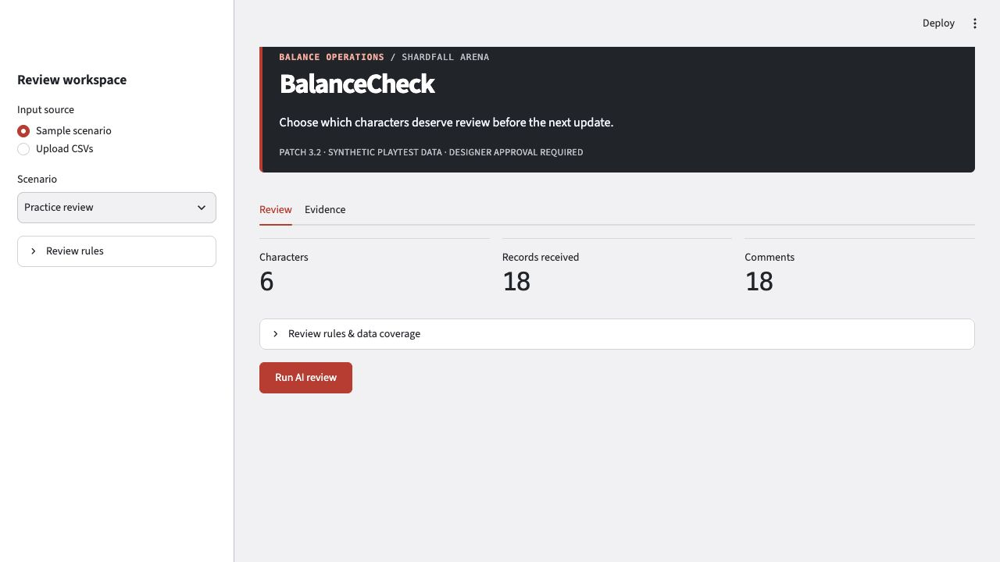
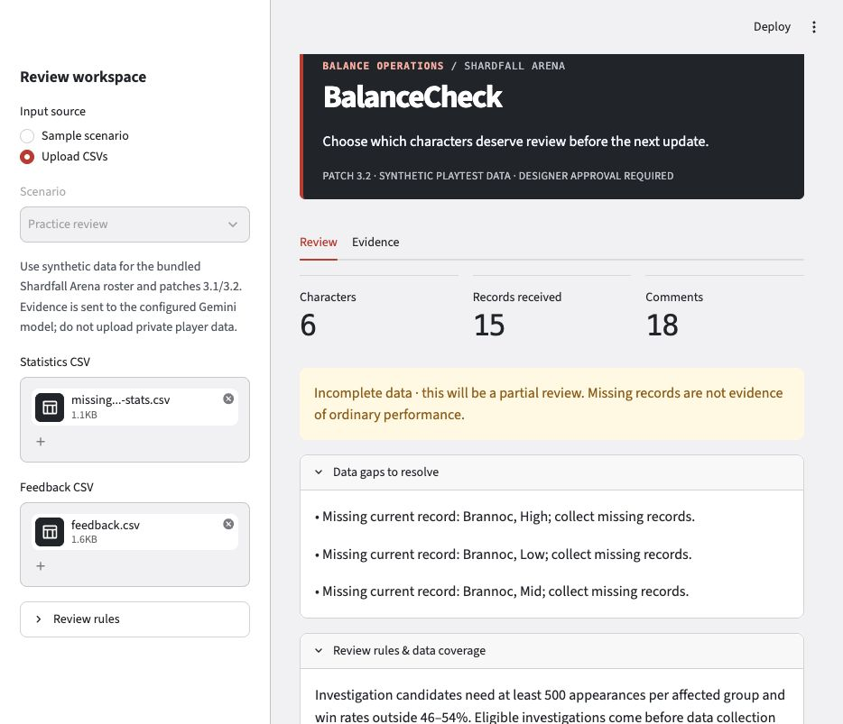
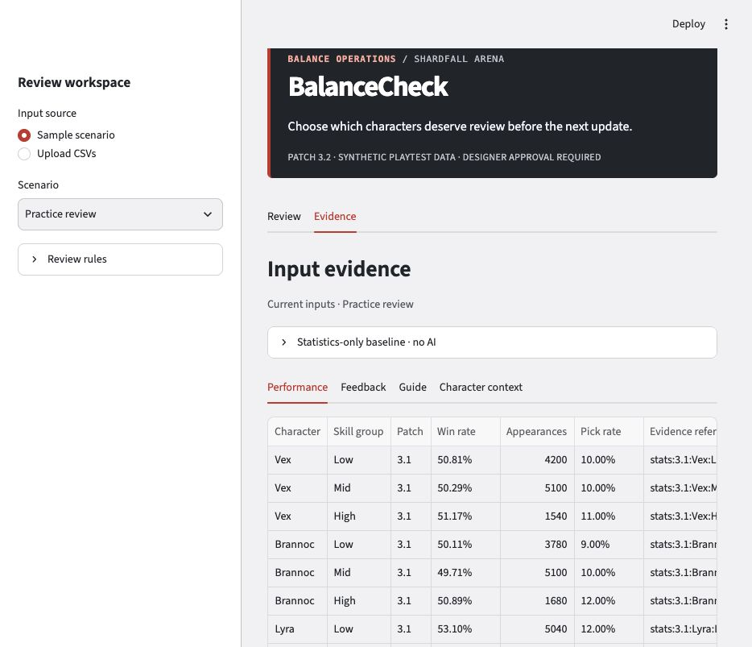
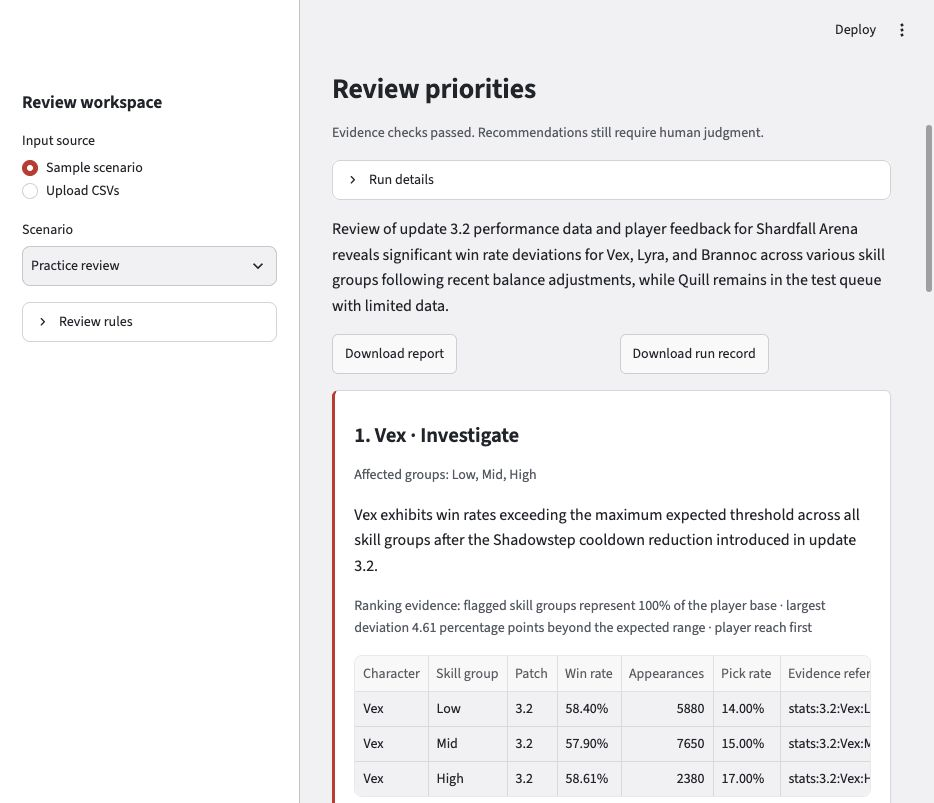
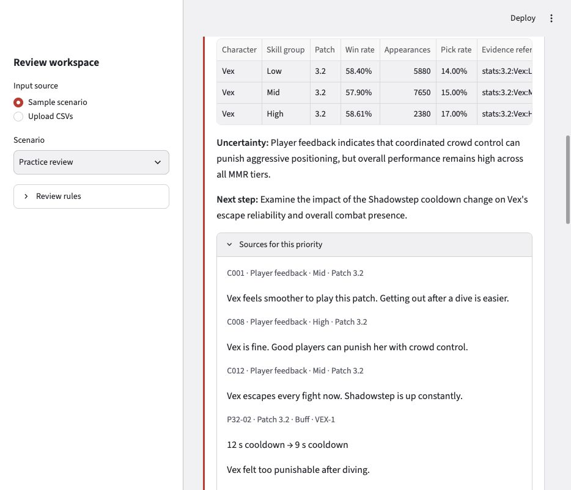

# Final usability and visual check — November 27, 2026

Scope: first visit, selecting inputs/rules, missing-data preflight, evidence inspection, a live practice review, cited sources, and downloads. Goal: a game designer or reviewer can complete a review without needing implementation knowledge; developers have a short route into the code.

## Findings and changes

The initial screen exposed filename-like scenario labels, repeated disclosure panels, opaque source IDs, and downloads below the whole report. The final screen uses readable scenario names, Review/Evidence navigation, one policy-and-coverage disclosure, source text beside each priority, and downloads above the priority list. Rule/scope detail is available when needed. Unchanged game definitions, human approval, and synthetic-data boundaries remain explicit.

The composition takes cues from [Figma's UI3 workspace](https://www.figma.com/blog/our-approach-to-designing-ui3/): a docked control panel and clear separation between controls and the main work. BalanceCheck uses a compact charcoal header, neutral canvas, consistent white panels, restrained coral, and aligned controls. This is an interpretation for a game analysis tool, not a reproduction of Figma or Riot assets. Presentation CSS is isolated in `.streamlit/style.css`.

## Browser-verified steps

1. **Choose inputs — healthy.** Practice review is the default; owner API/model controls are absent with credentials configured. Review and Evidence have distinct purposes. No tutorial is required to find Run.

   

2. **Validate uploads — healthy.** Two actual synthetic CSV uploads completed. Removing all of Brannoc's current records showed a partial-review warning, named each missing skill group, and counted 15 received records rather than counting the derived rows as received. The native upload control now agrees with the app's 2 MB limit. Redundant missing-count warnings for wholly absent records were removed.

   

3. **Inspect evidence — healthy.** Evidence opens the current performance, feedback, guide, character context, and a clearly labeled statistics baseline. It remains available without a model call. Reports retain their original sources when the current inputs change.

   

4. **Run and export — healthy.** A real Gemini practice review completed, passed validation, and returned Vex, Lyra, Brannoc in order. Two model requests. Both UI download controls produced files: JSON retained settings/evidence and omitted the server-local path; Markdown contained rules, calculated values, priorities, and coverage.

   

5. **Check a recommendation's sources — healthy.** The source disclosure showed the cited feedback, patch change, ability description, and a clearly labeled unapproved backlog proposal. Sources are displayed as text, rather than interpreted as instructions or HTML.

   

## Software checks and limits

54 automated checks pass, including API failure/invalid-output retry recovery, invalid-rule reset recovery, source disclosure, source preservation after input changes, settings isolation, all scenario loading, input validation, calculation and reference checks, and mock HTTP protocol behavior. See [actual final practice report](../examples/final_checks/polish_report.md) and [original run record](../examples/final_checks/polish_run.json).

The existing native labels, focus controls, tabs, and headings are preserved. Small-label opacity was corrected after inspecting actual computed styles. Dense evidence tables still use horizontal scrolling on narrow screens. This was a desktop browser flow check, not a full screen-reader/mobile/accessibility certification. No measured held-out accuracy or time savings is claimed. Gemini availability and project quota remain external dependencies. Designer approvals remain outside the app.
